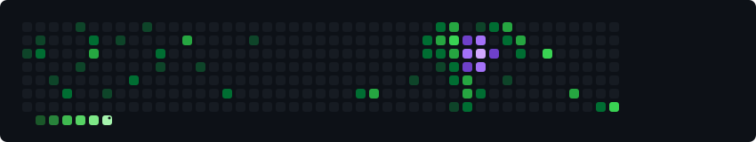

<!-- Header Banner -->

  

<!-- Animated Typing Text -->

  

<!-- Quick Social / Contact Badges -->

  
  
  
  

  
  
  

---

### 
👋 Hi, I'm Dipongkar Barmon

#### 
Aspiring Software Engineer · Full-Stack Developer

### 👨‍💻 About Me

CSE undergraduate at **Shahjalal University of Science and Technology (SUST)** (CGPA 3.55/4.00) who builds modern, high-performance web platforms with **React/Next.js, Node.js, Express, Spring Boot, and PostgreSQL/MongoDB**, deployed through **Docker & Linux**. Passionate about architecting scalable SaaS platforms, real-time systems, and distributed backends. Also an active competitive programmer with **800+ problems solved** across Codeforces, LeetCode, and CodeChef.

 

<!-- Currently & Open To Grid -->
<table width="100%">
<tr>
<td width="50%" valign="top">
<h4>🔭 Currently</h4>
<ul>
<li>🤖 Exploring <b>AI / LLM Integrations</b> with Next.js &amp; Vercel AI SDK</li>
<li>🏗️ Designing <b>scalable microservices &amp; backend pipelines</b> with Docker</li>
<li>🏥 Scaling <b>Healthcare Management System</b> with geospatial queries</li>
<li>📚 Deepening <b>system design &amp; distributed systems</b> for SWE roles</li>
</ul>
</td>
<td width="50%" valign="top">
<h4>🌱 Open To</h4>
<ul>
<li>✅ Full-time <b>Software Engineer</b> roles (graduating 2027)</li>
<li>✅ Summer <b>Internships</b> (Frontend / Backend / Full-Stack)</li>
<li>✅ <b>Freelance</b> web development &amp; full-stack projects</li>
<li>✅ <b>Open-source</b> collaborations &amp; hackathons</li>
</ul>
</td>
</tr>
</table>

 

### 🏆 Education & Achievements

| 🎖️ Achievement / Degree | Institution / Detail | Track / Outcome | Year |
| :--- | :--- | :--- | :---: |
| ⭐ **B.Sc. in Computer Science & Engineering** | **Shahjalal University of Science and Technology (SUST)** | 3rd Year · CGPA **3.55 / 4.00** | 2023 — 2027 (Exp.) |
| 🥇 **Higher Secondary Certificate (HSC)** | Dinajpur Govt. City College, Dinajpur | Science Background · **GPA 5.00 / 5.00** | 2020 — 2022 |
| 🎓 **Secondary School Certificate (SSC)** | Atwari Model Pilot High School | Science Background · Completed | 2015 — 2020 |
| 💡 **800+ Algorithmic Problems Solved** | Codeforces, LeetCode, CodeChef, AtCoder | Graph, DP, Trees, Segment Trees, DSU | Active |
| 🌟 **CodeChef Rated Coder** | CodeChef Competitions | **1-Star Rated Coder** · Consistent Division Contests | Active |

 

### 🚀 Featured Projects

<table width="100%">
<tr>
<!-- Project 1 -->
<td width="50%" valign="top">
<h3>🏥 Healthcare Management System</h3>

A full-stack emergency healthcare &amp; hospital platform — connects patients, doctors, and hospitals with real-time geospatial emergency dispatch and AI symptom triage.

<h4>Highlights</h4>
<ul>
<li>📍 Emergency hospital search with <b>2dsphere geospatial indexing</b> &amp; Haversine distance</li>
<li>🤖 AI symptom triage chatbot integrated via <b>Vercel AI SDK</b></li>
<li>🚑 Real-time emergency alerts &amp; ambulance coordination via <b>Socket.IO</b></li>
<li>🔐 Secure authentication with <b>Email OTP &amp; JWT</b> in httpOnly cookies</li>
<li>👨‍⚕️ Three role-based dashboards: <b>Patient · Doctor · Hospital Admin</b></li>
</ul>
<h4>Stack</h4>

 

🔗 <b>Live:</b> <a href="https://github.com/DipongkarBarmon" target="_blank">healthcare-management.vercel.app</a> 
💻 <b>Repo:</b> <a href="https://github.com/DipongkarBarmon" target="_blank">DipongkarBarmon/PH-Healthcare-Backend</a>

</td>
<!-- Project 2 -->
<td width="50%" valign="top">
<h3>📊 Project Management SaaS</h3>

An enterprise-grade agile project tracking &amp; team management platform — featuring interactive drag-and-drop Kanban boards, sprint lifecycles, and team analytics.

<h4>Highlights</h4>
<ul>
<li>📋 Interactive drag-and-drop <b>Kanban boards</b> for sprint lifecycles</li>
<li>👥 Multi-tenant workspace permissions &amp; role-based access control (RBAC)</li>
<li>📈 Task prioritization pipelines &amp; real-time sprint progress analytics</li>
<li>⚡ RESTful APIs engineered with <b>Prisma ORM &amp; PostgreSQL / MongoDB</b></li>
<li>🎨 Clean, responsive UI with state synchronization &amp; dark mode</li>
</ul>
<h4>Stack</h4>

 

🔗 <b>Live:</b> <a href="https://github.com/DipongkarBarmon" target="_blank">project-saas-track.vercel.app</a> 
💻 <b>Repo:</b> <a href="https://github.com/DipongkarBarmon" target="_blank">DipongkarBarmon/ProjectManagementSystem</a>

</td>
</tr>
<tr>
<!-- Project 3 -->
<td width="50%" valign="top">
<h3>🛠️ FixItNow (Home Service Marketplace)</h3>

An on-demand home service marketplace connecting customers with verified electricians, plumbers, and maintenance specialists.

<h4>Highlights</h4>
<ul>
<li>🔍 Categorized service discovery, instant keyword search &amp; filtering</li>
<li>📅 Interactive booking schedules with live status tracking</li>
<li>🛡️ Secure token-based authorization and authenticated order workflows</li>
</ul>
<h4>Stack</h4>

💻 <b>Repo:</b> <a href="https://github.com/DipongkarBarmon" target="_blank">DipongkarBarmon/fixitnow-frontend</a>

</td>
<!-- Project 4 -->
<td width="50%" valign="top">
<h3>🎓 EduLearn (Learning Management System)</h3>

A comprehensive LMS platform supporting online courses, video lecture distribution, interactive quizzes, and instructor financial ledgers.

<h4>Highlights</h4>
<ul>
<li>👥 Multi-role portals for <b>Admin, Instructor, and Enrolled Learner</b></li>
<li>🎥 Cloud video streaming &amp; course uploads integrated with <b>Cloudinary</b></li>
<li>💳 Instructor balance tracking, withdrawal requests &amp; revenue analytics</li>
</ul>
<h4>Stack</h4>

 

💻 <b>Repo:</b> <a href="https://github.com/DipongkarBarmon" target="_blank">DipongkarBarmon/learning-management-system</a>

</td>
</tr>
</table>

 

### 🛠️ Tech Stack

| Domain | Technologies & Tools |
| :--- | :--- |
| **🧠 Languages** |  |
| **🎨 Frontend** |  |
| **⚙️ Backend** |  |
| **🗄️ Databases** |  |
| **🚀 DevOps / Cloud** |  |
| **🤖 AI & ML** |      |
| **🧰 Tools & Platforms** |  |

 

### 📊 GitHub Stats

  <table border="0">
    <tr>
      <td align="center" valign="middle">
        
      </td>
    </tr>
    <tr>
      <td align="center" valign="middle">
        
        &nbsp;&nbsp;
        
      </td>
    </tr>
    <tr>
      <td align="center" valign="middle">
        
      </td>
    </tr>
  </table>

 

### 🏅 Competitive Programming

  
  &nbsp;
  
  &nbsp;
  

  <b>800+ problems solved</b> · <b>1★ @ CodeChef</b> · <b>LeetCode: Dipongkar_Barmon-123</b> · <b>Active across Codeforces & AtCoder</b>

 

### 🐍 Contribution Snake

  

 

### 📫 Connect With Me

  
  &nbsp;
  
  &nbsp;
  
  &nbsp;
  
  &nbsp;
  

 

<!-- Footer Wave Banner -->

  
  
  

    Built with care by <a href="https://dipongkar-barmon.vercel.app/" target="_blank"><b>Dipongkar Barmon</b></a> · Last updated: <b>October 2026</b> · 💜 Open to opportunities
  

